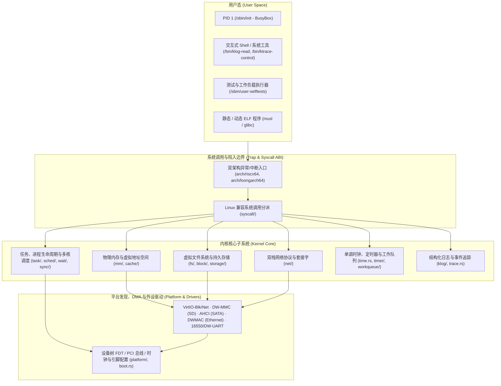

# NPUcore-BLOSSOM

`NPUcore-BLOSSOM` 是一个使用 Rust（`no_std`）编写的兼容 Linux ABI 的双架构多核宏内核操作系统，原生支持 **RISC-V 64**（`riscv64`）与 **LoongArch 64**（`loongarch64`）指令集架构，可在 QEMU 虚拟机以及 **StarFive VisionFive 2**（JH7110）、**Loongson 2K1000LA** 实体开发板上运行。

---

## 一、支持平台与工具链基线

| 架构 (`ARCH`) | 编译器 Target | 支持平台 (`TARGET_PLATFORM`) | 地址空间与内存映射机制 |
| :--- | :--- | :--- | :--- |
| `riscv64` | `riscv64gc-unknown-none-elf` | `qemu-virt`、`visionfive2` | Sv39 三级页表（4KiB 页，高半核线性直映与 MMIO 映射） |
| `loongarch64` | `loongarch64-unknown-none` | `qemu-virt`、`ls2k1000la` | PLV0 直接映射配置窗口（DMW）+ PLV3 三级 4KiB 用户页表与软硬件协同 TLB 重填 |

- **Rust 工具链**：固定 `nightly-2025-01-18`（含 `rust-src`，由 `os/.cargo/config.toml` 统一使用离线 `vendor` 重编 `core`、`alloc` 与 `compiler-builtins`）。
- **模拟器与宿主工具**：QEMU `9.2.1`（`qemu-system-riscv64`、`qemu-system-loongarch64`）、GNU Make、Python 3、`e2fsprogs`（`mke2fs`、`debugfs`、`e2fsck`、`dumpe2fs`）、`dtc`、`fdtput`、双架构 musl 交叉 GCC 工具链。

---

## 二、系统架构与核心子系统



### 1. 启动、双架构底座与多核同步（`boot.rs`, `platform/`, `arch/`, `cpu.rs`, `irq.rs`, `sync/`）
- **两阶段启动与资源发现**：主核（BSP）在早期单核阶段解析设备树（FDT）或固件参数，校验物理内存（RAM）、保留区（`reserved-memory` / `no-map`）、内核镜像、initrd 与外设 MMIO/IRQ 拓扑，将只读 `BootInfo` 冻结发布后拉起所有从核（AP）。
- **中断与跨核调用**：支持外部中断描述符表、共享中断行为链（Action Chain）与同步注销等待；提供基于单向无锁队列的跨核同步函数调用（CSD / `cpu::call`）与远程 TLB 同步支持。
- **同步原语**：提供关中断自旋锁（`SpinLock`）、关抢占守卫（`PreemptGuard`）、可睡眠互斥锁（`SleepMutex`）、写者防饥饿可睡眠读写锁（`SleepRwLock`）、完成量（`Completion`）及侵入式等待队列（`WaitQueue`）。

### 2. 物理内存管理与用户虚拟地址空间（`mm/`, `cache/`）
- **分层物理页分配**：启动期区间分配器（`BootMemory`）➔ 伙伴系统（`Buddy`，支持阶合并与指定物理地址窗口分配）➔ 每 CPU 页帧缓存（`PCP`）➔ 经典 `SLUB` 小对象分配器与全局内核堆。
- **物理页缓存与反向映射（`Folio` & `cache`）**：4KiB 引用计数物理页容器（`FolioRef`），内联扇区级有效/脏/回写位图；支持块设备元数据页共享缓存（`MetadataCache`）与文件页稀疏基数树索引（`FolioIndex`）、双链全局 LRU 页面回收（Active/Inactive）及预留回写池。
- **用户虚拟内存（`Mm`）**：管理虚拟内存区域（`VMA`）、匿名页与文件页映射（共享 `MAP_SHARED` 与私有写时复制 `MAP_PRIVATE` COW）、按需缺页分配、栈自动向下增长、跨页安全用户态访存（`uaccess`）以及 LoongArch64 非对齐访存指令（ALE）内核态模拟。
- **DMA 一致性与生命周期（`mm/dma`）**：区分一致性 DMA 映射与流式物理页载荷映射（`MappedPages`），结合硬件 DMA 域地址转换窗口与非一致性缓存刷写/失效维护（如 JH7110 SiFive CCache `FLUSH64`）。

### 3. 任务调度、进程、信号与用户态执行（`task/`, `sched/`, `time.rs`, `timer/`, `workqueue/`）
- **两阶段上下文切换与多核调度**：每个内核任务拥有独立 64KiB 内核栈；切换过程经由每 CPU 静态调度栈中转以安全释放或迁移前序任务栈，支持 `sched_setaffinity` / `sched_getaffinity` 多核亲和性绑定与跨核迁移。
- **进程组、会话与 ELF 装载**：支持 `clone` / `fork` / `vfork`、`execve`（静态与动态 `PT_INTERP` ELF64 装载及 `#!` 脚本解释器展开）、`wait4` 子进程回收、孤儿进程向系统 `PID 1` 托管、`futex` 快速用户态互斥锁以及 POSIX 资源限额（`prlimit64` / `rusage`）。
- **完备信号机制**：支持线程级与进程组级挂起信号队列、实时信号排队、`sigaltstack` 备用信号栈、双架构用户态 `rt_sigframe` 现场构造与 `rt_sigreturn` 恢复，以及阻塞系统调用的信号中断与 `ERESTARTSYS` 自动重启。
- **时钟、定时器与工作队列**：基于硬件计数器定点数换算的单调时钟與顺序锁（SeqLock）实时时钟；每 CPU 高精度红黑树定时器（`Timer`）与 8 层粗粒度时间轮（`Wheel`）；支持每 CPU 共享工作者池、按需扩缩容、OOM 救援线程（Rescuer）与双色排空（Two-Color Flush）的异步工作队列（`WorkQueue` / `DelayedWork`）。

### 4. 块设备层、虚拟文件系统与行规程终端（`block/`, `storage.rs`, `fs/`, `drivers/`）
- **块层与存储驱动**：父子拆分 `Bio` 请求模型、预分配固定请求槽、扇区合并与停机排空隔离；支持 VirtIO-Blk（MMIO v1/v2 与 PCI）、RAM Disk、DesignWare SD/MMC（IDMAC 链式描述符 + 64KiB 跳板缓冲）与 AHCI SATA（H2D FIS + PRDT），原生解析 MBR 与 GPT 1.0 分区表。
- **Ext4 与 VFS 命名空间**：支持无日志 `ext4` 读写挂载（Extent 树与传统多级间接块映射、HTree 哈希索引目录与分裂、块/Inode 位图分配、截断与孤儿节点回收、后台周期回写与 `fsync`/`sync` 错误游标 `errseq` 追踪）；提供单飞（Singleflight）并发加载的 `InodeCache` 与 `DentryCache`、挂载树穿越（`Mount` / `Vfs`）及 64 槽位图分页文件描述符表（`FileTable`）。
- **伪文件系统与 IPC**：支持 `tmpfs`（内存页与节点配额控制）、`devfs`（`/dev/null`、`/dev/zero`、`/dev/tty`、`/dev/console`、`/dev/kmsg`、`/dev/ktrace` 及块设备节点）、`procfs`（`/proc/mounts`、`/proc/meminfo`、`/proc/uptime`、`/proc/interrupts`、`/proc/cmdline`）、匿名管道（`pipe2`）、零拷贝传输（`splice` / `copy_file_range`）以及 `poll` / `ppoll` / `pselect6` / `epoll`（支持水平触发与边缘触发 `EPOLLET`、AVL 树索引与就绪队列锁外扫描）。
- **串口与 `N_TTY` 行规程**：驱动 16550 与 Synopsys DesignWare APB UART，实现规范模式（Canonical 行编辑、回显、信号字符 `INTR`/`QUIT`/`SUSP`）与原始模式（Raw）、前台进程组作业控制（`TIOCGPGRP`/`TIOCSPGRP`）及窗口大小调整。

### 5. 网络协议栈与内核可观测性（`net/`, `klog/`, `trace.rs`）
- **双协议族网络栈**：基于 `smoltcp` 构建 IPv4 / IPv6 双栈（含 IPv4-mapped IPv6 地址兼容），驱动环回接口（`lo`）与以太网接口（`eth0`：VirtIO-Net 及板载 DWMAC4 / DWMAC1000 千兆网卡 + YT8531/YT8511 PHY）；支持 `TCP`（监听半连接/全连接队列、冷态按需分配与异步协议排空退役）、`UDP`（端口租约 `BindingLease` 保活）、`AF_UNIX` 本地套接字（`SOCK_STREAM` / `SOCK_DGRAM` / `SOCK_SEQPACKET`）及 `ioctl` 接口/路由配置。
- **结构化日志与事件追踪**：提供多核无阻塞环形日志缓冲区（`klog`，支持后台打印服务与 `/dev/kmsg` 非阻塞读取）及每 CPU 事件追踪缓冲区（`/dev/ktrace`，支持通过 `ioctl` 启动采样、跨核停稳冻结与快照导出）。

---

## 三、仓库目录结构

```text
.
├── Makefile                    # 顶层统一构建、镜像制作、测试与 QEMU 运行入口
├── rust-toolchain.toml         # 固定 Rust 工具链配置 (nightly-2025-01-18)
├── os/                         # 内核源码包 (no_std)
│   ├── build.rs                # 平台链接布局与测试段脚本生成
│   ├── dts/                    # 仓内开发板设备树源码 (VisionFive 2 & LS2K1000LA)
│   └── src/                    # 内核各子系统实现与内核自测套件 (ktest)
├── crates/                     # 内核测试框架公共库
│   ├── ktest/                  # no_std 测试运行时、生命周期状态机与断言原语
│   └── ktest-macros/           # #[ktest::suite] 与 #[case] 过程宏展开
├── userland/                   # 用户态程序、配置与运行库准备
│   ├── contest-run/            # 用户态测试与自测执行器 (contest-run / user-selftests)
│   ├── include/ & tools/       # /dev/kmsg 与 /dev/ktrace 用户态工具 (klog-read, ktrace-control)
│   ├── runtime/                # 动态链接运行库准备脚本与说明
│   └── system/                 # 根文件系统基础配置 (/etc/inittab, init.d/rcS, rcK, network)
├── tests/user/                 # 用户态 C 语言回归测试套件 (kselftest / TAP) 与底层 ABI 探针
├── tools/                      # 宿主机侧镜像构建、开发板打包、QEMU 会话管理与 ktest 协议驱动脚本
├── dependency/                 # 仓内第三方源码依赖 (BusyBox, smoltcp, virtio-drivers, fdt, unwinding)
└── docs/                       # 公开开发、测试、代码规范与开发板上板指南
```

---

## 四、快速开始

### 1. 构建内核与根文件系统镜像

```sh
# 查看所有公开 Make 目标与参数说明
make help

# 单独编译内核 ELF（默认 ARCH=riscv64, TARGET_PLATFORM=qemu-virt, KERNEL_BUILD_PROFILE=debug）
make build-kernel ARCH=riscv64
make build-kernel ARCH=loongarch64 KERNEL_BUILD_PROFILE=release

# 编译用户态程序（BusyBox、C 工具与 Rust std 执行器）、装配根文件系统并生成 ext4 镜像
make assemble-root-filesystem ARCH=riscv64 ROOTFS_OUTPUT_DIR=build/rootfs/riscv64
make create-ext4-image ARCH=riscv64 \
  ROOTFS_TREE_DIR=build/rootfs/riscv64 \
  SYSTEM_ROOT_EXT4_IMAGE=disk.img

# 一键构建双架构 release 内核与单根 ext4 镜像（导出 kernel-rv, kernel-la, disk.img, disk-la.img）
make all
```

### 2. 在 QEMU 中启动系统

`make run-qemu` 会在独立的工作盘副本（`root.raw`）上启动系统，自动加文件锁保护源镜像不被篡改：

```sh
# 启动 RISC-V 64 交互式 BusyBox Shell（单系统盘模式，可读写挂载）
make run-qemu ARCH=riscv64 QEMU_ARGS='--shell --system-only --root-mode rw'

# 启动 LoongArch 64 交互式 BusyBox Shell
make run-qemu ARCH=loongarch64 QEMU_ARGS='--shell --system-only --root-mode rw'

# 开启 GDB 调试桩暂停等待连接（默认端口 1234）
make run-qemu ARCH=riscv64 QEMU_ARGS='--shell --system-only --debug --gdb-port 1234'
```

在客户机 Shell 中执行完命令后，可通过以下命令同步磁盘并自然关机：

```sh
sync
/bin/busybox poweroff
```

---

## 五、分层测试与质量检查

本项目提供从宿主机工具单元测试、内核白盒集成测试到用户态系统调用自测的完整验证体系：

```sh
# 1. 宿主机工具链与协议解析器单元测试
python3 -m unittest discover -s tools/ktest

# 2. 列出或运行内核具名白盒测试套件 (ktest，支持通配符过滤与多核配置)
make list-kernel-tests ARCH=riscv64 CPUS=2 TEST='*folio*'
make run-kernel-tests ARCH=riscv64 CPUS=2 TEST='*folio*'
make run-kernel-tests ARCH=loongarch64 CPUS=2 TEST='*tty*'

# 3. 运行用户态 Linux ABI 自测套件 (启动真实 PID 1 跑完 TAP 套件并自然关机对账)
make run-user-selftests ARCH=riscv64
make run-user-selftests ARCH=loongarch64 USER_SELFTEST_ARGS='--collection fs'

# 4. 内核静态代码检查 (Clippy 严格模式与只读格式检查)
cd os && BLOSSOM_PLATFORM=qemu-virt cargo clippy --locked --target riscv64gc-unknown-none-elf --profile dev
cd os && BLOSSOM_PLATFORM=qemu-virt cargo clippy --locked --target loongarch64-unknown-none --profile dev
```

---

## 六、开发板构建与更多文档

针对实体开发板（VisionFive 2 与 Loongson 2K1000LA），项目支持从仓内源码直接编译设备树（DTB）并生成离线 U-Boot 启动包（`kernel.uImage`、`root.uInitrd`、`board.dtb`、`boot.env`）：

```sh
# 生成开发板设备树 DTB
make build-board-dtb ARCH=riscv64 TARGET_PLATFORM=visionfive2
make build-board-dtb ARCH=loongarch64 TARGET_PLATFORM=ls2k1000la

# 打包开发板离线启动镜像
make package-board-boot-images ARCH=riscv64 TARGET_PLATFORM=visionfive2 \
  KERNEL_BUILD_PROFILE=release BOARD_BOOT_IMAGES_OUTPUT_DIR=build/vf2-boot \
  BOARD_ROOT_EXT4_IMAGE=disk.img BOARD_ROOT_DEVICE=/dev/ram0 \
  BOARD_ROOT_MODE=rw BOARD_OS_DTB=build/board/riscv64/visionfive2/board-input.dtb
```

更多详细说明请参阅仓库内的技术文档：

- **[开发、测试与代码规范指南 (`docs/development.md`)](docs/development.md)**：环境准备、构建目标详解、QEMU 工作盘管理、三层测试体系、Clippy 例外规则、代码排版与注释编写规范。
- **[开发板上板与根卷指南 (`docs/boards.md`)](docs/boards.md)**：VisionFive 2 与 2K1000LA 的固件环境检查、RAM 根与 SD/SATA 持久分区部署、网络配置与实板验证说明。
- **[源码导读与运行根说明 (`userland/runtime/development.md`)](userland/runtime/development.md)**：内核活跃模块导航表、单命令执行模式与新功能开发路线。
- **[动态运行库准备说明 (`userland/runtime/sources.md`)](userland/runtime/sources.md)**：`musl` / `glibc` 动态链接器与共享库资产准备流程。
